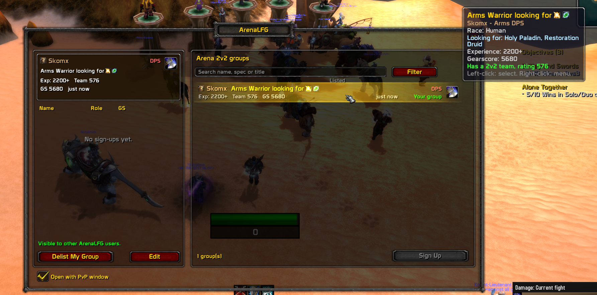

# ArenaLFG

**A 2v2 arena partner finder for WoW 3.3.5a (WotLK).** Stop scrolling through global chat: see who is looking for a 2v2 partner, sign up with one click, or list your own group, in a window modeled on the Premade Groups finder from modern WoW.

> Built for Warmane (Blackrock) but should work on any 3.3.5a server that allows custom chat channels.



## Features

- **Group browser** with class-colored player names, race icons to help identify faction, specialization icons, listing age, search and filters for role, team / no team, seasonal / non-seasonal, and "10 games only".
- **Sign Up flow** like retail: pick a group, press *Sign Up*, the leader sees you in their applicants list and can *Invite* or decline.
- **Application alerts:** incoming sign-ups are reported in chat, with a sound alert when the ArenaLFG window is closed.
- **List your group** with role, gearscore, experience tier, preferred partner specs, a short title and flags (seasonal character, 10 games for arena points). The listed-group card mirrors the browser listing and shows your race, class-colored name, role, title, team details and listing age. Settings are saved separately for each character.
- **Preferred partner specs:** choose a role, then select one or more specs or choose **Any spec** (for example, Healer → Holy Paladin and Restoration Druid, or any Healer); their icons or role preference appear in the displayed group title.
- **Auto-detection**: your class, race, spec, 2v2 team and team rating are read from the game. When a GearScore addon exposes `GearScore_GetScore`, ArenaLFG reads your gearscore through that API; otherwise, the gearscore you enter is self-reported.
- **Roles:** DPS, Healer, Tank. Your role is automatically detected from your class and primary talent tree and shown in your listing.
- **PvP UI integration:** enabled by default; ArenaLFG opens beside the PvP window when you open it (H is the default WoW PvP keybinding). Use the main-window checkbox or `/alfg pvp` to toggle the integration. The minimap button and `/alfg` always open ArenaLFG manually.
- **Clean chat:** sync traffic is filtered from your chat windows. Listing data is sent as plain text, so anyone who joins the sync channel can read it.

## Installation

1. Download `ArenaLFG-v1.2.0.zip` from the [Releases page](../../releases) (do **not** use "Download ZIP" on the repository page, it creates a wrongly named folder).
2. Extract it into your addons folder so the path looks like:
   ```
   World of Warcraft\Interface\AddOns\ArenaLFG\ArenaLFG.toc
   ```
3. Start the game and make sure **ArenaLFG** is ticked in the *AddOns* list at character select.

The folder must be named exactly `ArenaLFG`.

## Usage

| Action | How |
| --- | --- |
| Open / close the window | Click the minimap button or type `/alfg` to toggle; open the PvP window (H by default) to open ArenaLFG beside it |
| List your group | Left panel, fill the form, press **List Group** |
| Edit or remove your group | **Edit** / **Delist My Group** (also in the right-click menu on your row) |
| Sign up to a group | Click a group in the list, then **Sign Up** |
| Cancel a sign-up | Select the group, press **Cancel Sign-Up** |
| Invite an applicant | Press **Invite** next to their name (sends a normal party invite) |
| Refresh the list | The refresh button asks other players to announce their groups again; if it is still on cooldown, the remaining wait is shown in chat |

Listings expire automatically if the poster goes offline. Pending sign-ups clear when that leader's listing expires, and unhandled applicants expire after about 2.5 minutes. Your listing can restore after a quick reload, but a saved listing older than five minutes is cleared on login. A saved listing is also removed when you are grouped or enter an arena or battleground.

### Notes on your profile

When you sign up to someone's group, the leader receives your role, spec, gearscore, team rating and experience tier. These come from the same form you use to list your own group, so fill it in once.

### Slash commands

| Command | Description |
| --- | --- |
| `/alfg` or `/arenalfg` | Toggle the window |
| `/alfg help` | Show available commands and what they do |
| `/alfg minimap` | Show or hide the minimap button |
| `/alfg pvp` | Toggle PvP window integration (enabled by default; also controlled by the main-window checkbox) |
| `/alfg me` | Print what the addon detects about your character (class, spec, GS, arena teams) |
| `/alfg comm` | Show sync channel status; retry joining if disconnected |
| `/alfg debug` | Toggle debug messages (sent / received data) |
| `/alfg clear` | Clear the local list |

## How it works

3.3.5 addons cannot access the internet, so ArenaLFG syncs through the game itself:

- **Listings** are sent as plain text in a custom channel called `ArenaLFGSync`. The addon joins it automatically, retrying up to three times if the initial join fails. `/alfg comm` checks the connection and retries if disconnected. The channel is removed from your chat windows and its messages and join/leave notices are filtered. The traffic is not private: anyone who joins that channel can see it. Every 60 seconds your listing is re-announced; a listing disappears after about 2.5 minutes without an update. Refresh requests are limited to one every 10 seconds; posters queue responses until their broadcast cooldown ends, then add a short random delay to spread out replies.
- **Sign-ups, invites and declines** are private addon messages sent directly between the two players.
- ArenaLFG turns the channel messages into listings. Players without the addon who join the channel can read the raw messages. Alliance and Horde use separate lists, as the game does not allow channel chat across factions.

### Privacy

When you list a group, your **character name, class, spec, role, gearscore, 2v2 team rating (if you have a team), experience tier, flags and title** are visible to other ArenaLFG users. When you sign up to a group, the same profile is sent privately to that leader. Nothing is sent outside the game and there is no external server.

## Requirements

- WoW client **3.3.5a** (interface 30300).
- Optional: a compatible GearScore addon (GearScore / GearScoreLite). Without one, or if its score API is unavailable, enter your gearscore by hand; other players cannot verify that value.

## Troubleshooting

- **"Could not join the sync channel":** the server may restrict custom channels, or you already have the maximum number of channels. Free a channel slot, then run `/alfg comm` to retry joining.
- **The list stays empty:** the addon is only useful when other players run it too. Ask a friend to install it, post a group, and press the refresh button.
- **Your 2v2 team is not detected:** run `/alfg me` and check the arena slots it prints. Open the PvP / arena team frame once, then `/reload`.
- **The addon does not appear in the AddOns list:** check that the folder is named `ArenaLFG` and contains `ArenaLFG.toc` directly (not another folder inside).
- **Lua errors:** enable error display with `/console scriptErrors 1` and open an issue with the message.

## Known limitations

- Visible listings depend on how many players run the addon.
- Gearscore is self-reported (or read from your GearScore addon), so it can be edited by the player.
- Solo-queue style teams reported by the server are ignored; only real 2v2 teams count.

## Contributing / bug reports

Issues and pull requests are welcome. When reporting a bug, include your addon version, the output of `/alfg me` and `/alfg comm`, and any Lua error text.

## License

[MIT](LICENSE)
